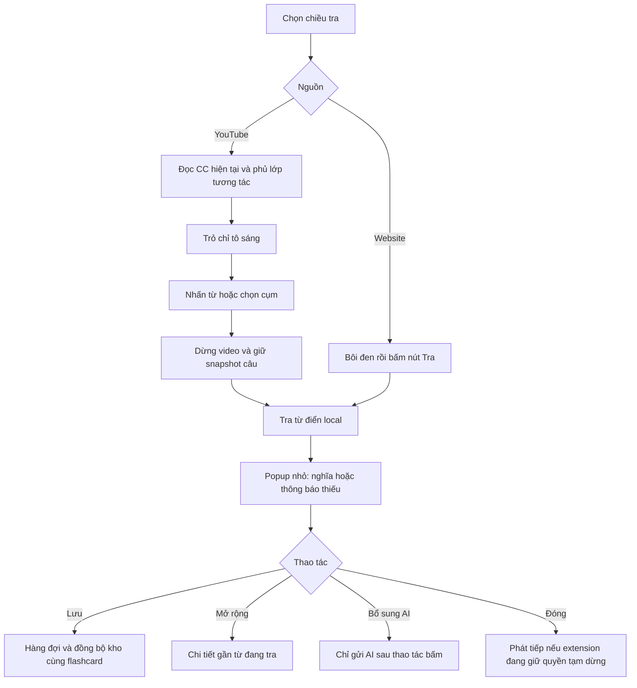
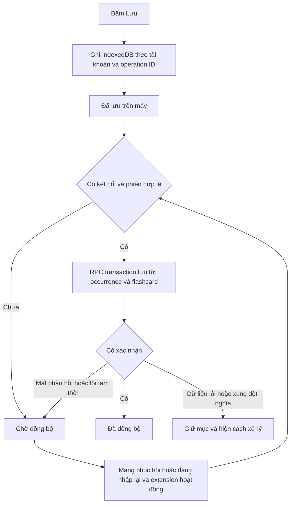
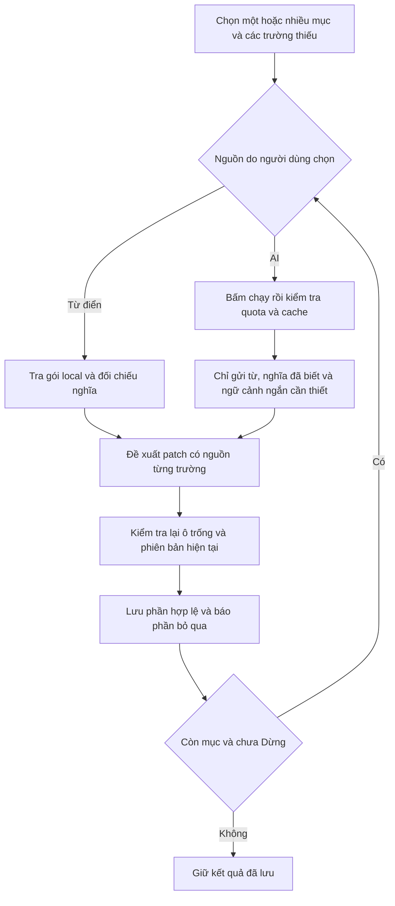

# Kế hoạch Chrome extension tra từ và học flashcard

Ngày lập: 15 tháng 10 năm 2026. Cập nhật: 20 tháng 10 năm 2026. Trạng thái: đang triển khai theo checklist; kết quả và giới hạn môi trường được ghi trong `IMPLEMENTATION_LOG.md`.

**Điều chỉnh ngày 20/10:** bỏ nghe phát âm theo yêu cầu; giữ IPA. Chủ dự án chưa có hosting/R2/Store nên phạm vi phát hành hiện là chuẩn bị gói và hướng dẫn, chưa upload/deploy/submission. Xem `docs/extension/RELEASE.md` và nhật ký triển khai.

Extension phủ lớp tương tác lên CC đang hiển thị của YouTube, tra từ trên website bằng từ điển nội bộ, rồi đồng bộ từ và flashcard về Phrasebook. AI chỉ chạy khi người dùng bấm yêu cầu. Thiết kế giữ ID mục từ và tiến độ học hiện có, đồng thời bổ sung nguồn gặp từ và dữ liệu ngữ nghĩa còn thiếu.

Thực hiện theo [checklist từng bước](PLAN_EXTENSION_STEPS.md). Mỗi bước có đầu vào, thao tác, cách kiểm tra và điều kiện hoàn thành. Plan này mô tả thiết kế; checklist là thứ tự thực hiện và ghi bằng chứng nghiệm thu. Các ô kiểm tra đều chưa thực hiện trong giai đoạn lập kế hoạch.

## 1 Phạm vi đã chốt

| Phần | Hành vi |
| --- | --- |
| YouTube | Đọc text và vị trí CC hiện tại; dựng lớp tương tác tại cùng vị trí. Không tích hợp YouTube Data API hoặc tải transcript toàn video. |
| Nội dung CC | Giữ phụ đề gốc. Không tự dịch cả câu. Video phải có CC đang bật. |
| Trỏ chuột | Chỉ tô sáng từ; không dừng video, không gọi AI. |
| Nhấn từ | Dừng video và mở popup nghĩa cơ bản theo chế độ đã chọn. |
| Cụm từ | Kéo chọn cụm trên lớp CC; sau khi kết thúc chọn mới tra và mở popup. |
| Website | Bôi đen từ/cụm, hiện nút Tra, bấm nút mới mở popup. |
| Popup nhỏ | Nghĩa cơ bản, chọn nghĩa, Lưu, Mở rộng và Đóng. |
| Popup mở rộng | Mở gần từ, giữ trong vùng hiển thị; hiện chi tiết có sẵn. |
| Đóng popup | Popup nhỏ tự đóng sau khoảng 300 ms khi rời cả từ lẫn popup; hỗ trợ X, Esc, bấm ngoài. Phần mở rộng chỉ đóng chủ động. |
| Phát tiếp | Chỉ phát tiếp khi extension đã dừng video và người dùng chưa chủ động đổi trạng thái video. |
| Lưu | Lưu mục học, ngữ cảnh và thêm flashcard trong cùng thao tác. |
| Ôn thẻ | Ôn trên web app; extension có nút mở trang Flashcard. |
| Ngôn ngữ | Anh–Anh, Anh–Việt, Việt–Anh; không tự lấy thêm kết quả ngoài chế độ đã chọn. |
| AI | Chỉ gọi khi bấm Bổ sung bằng AI. Mở popup, Mở rộng và Lưu không tự gọi AI. |
| Bổ sung | Từng từ hoặc nhiều từ theo nhóm; chọn nguồn Từ điển hoặc AI; có tiến độ và Dừng. Chỉ điền ô trống. |
| Offline | Tra gói từ điển đã tải và ghi hàng đợi trong extension. Đồng bộ lại khi có kết nối và extension hoạt động. |

Bản thử nghiệm dùng Load unpacked; bản phân phối cho người dùng cài từ Chrome Web Store. Gói từ điển được phân phối độc lập qua Cloudflare R2 với custom domain/CDN; web và API Next.js ở Vercel, tài khoản và dữ liệu cá nhân ở Supabase. Mỗi profile Chrome tải gói cần dùng và lưu trong IndexedDB; không tải lại cho mỗi lần tra. Store cập nhật mã extension, manifest dữ liệu điều khiển cập nhật gói từ điển.

Phát hành theo thứ tự beta kín, Store private/unlisted rồi mở rộng người dùng khi backend đã đủ điều kiện. Unlisted chỉ là hạn chế khả năng tìm thấy, không phải kiểm soát ai được dùng backend. Quyền tài khoản vẫn do server và RLS quyết định. Học flashcard offline trên web, dịch nguyên câu tự động, nhận dạng âm thanh và phụ đề nằm trong hình ảnh video không thuộc bản này.

## 2 Kết quả đọc source và phạm vi ảnh hưởng

Đã đối chiếu cấu hình build, ba migration, đăng nhập Google, proxy, API dịch và gợi ý, CRUD kho từ, flashcard, bộ học ngày, quota, nhập/xuất và các giao diện tương ứng. Dự án hiện chưa có extension hoặc engine từ điển.

| Source hiện tại | Phát hiện | Thay đổi cần thiết |
| --- | --- | --- |
| `src/lib/normalize.ts:5` và `src/app/api/vocabulary/route.ts:40` | `meaningKey` ưu tiên nghĩa Anh, nếu thiếu lấy nghĩa Việt, rồi cắt 180 ký tự. Bổ sung nghĩa Anh có thể đổi khóa của cùng mục từ. | Tách danh tính nghĩa khỏi nội dung định nghĩa; giữ ID cũ và lưu tham chiếu để tra lại. Không chỉ sửa một hàm chuẩn hóa. |
| `supabase/migrations/001_initial.sql:50` | Unique đang dựa vào từ chuẩn hóa, ngôn ngữ và nghĩa chuẩn hóa. | Chuyển theo từng giai đoạn sau khi thay mọi writer sử dụng khóa cũ. |
| `src/app/api/vocabulary/route.ts:48` | Gặp mục trùng thì trả mục cũ ngay; không bổ sung lần gặp mới. GET đọc toàn kho. | Thêm thao tác capture có kiểm tra trùng và lưu occurrence; lookup trạng thái theo các từ cần tra, không tải toàn kho mỗi lần nhấn. |
| `src/app/api/flashcards/route.ts:75` | Flashcard đã có unique theo user và mục từ; `ignoreDuplicates` giữ thẻ đã tồn tại. Tuy nhiên lưu từ và tạo thẻ là hai API riêng. | Dùng lại bảng flashcards; RPC transaction mới thực hiện capture và tạo thẻ, không reset status hay ngày bộ học cũ. |
| `src/features/vocabulary/flashcards-view.tsx:58` | Mặt thẻ đang fallback sang ngôn ngữ khác. Nhãn luôn giả định `term` là tiếng Anh. | Chỉ hiện nội dung đúng chế độ; thêm trạng thái thiếu và đường dẫn bổ sung. Phân biệt mục nguồn Việt cũ để không gắn nhãn sai. |
| `src/features/translation/chat-workspace.tsx:176` | Gợi ý được lưu thành mục tiếng Anh kể cả đầu vào Việt; có hoàn tác bằng cách xóa mục vừa tạo. | Luồng extension Việt–Anh cũng chọn ứng viên Anh làm mục học. Dùng chung service lưu và giữ hợp đồng `already_existed`; kiểm tra hoàn tác không xóa mục đã có thêm ngữ cảnh/thẻ. |
| `src/app/api/suggestions/route.ts:73` | Loại từ đã lưu theo chữ, chưa xét nghĩa; có lọc CEFR/IELTS. | Không dùng endpoint này để tra từ hoặc điền nghĩa. Giữ luồng gợi ý hiện tại; engine mới vẫn tra được nghĩa khác của từ đã lưu. |
| `src/app/api/import/route.ts:129` | Upsert và phục hồi liên kết thẻ/bộ học dựa vào khóa nghĩa. | Chuyển importer cùng lần thay identity; hỗ trợ JSON cũ và mapping ID rõ ràng. |
| `src/app/api/export/route.ts:83` và `src/lib/vocabulary-csv.ts:1` | JSON hiện version 3; select và CSV liệt kê trường cố định. | Xuất version 4 gồm trường mới và occurrences; vẫn nhập version 1–3 và CSV cũ. |
| `src/app/api/import/route.ts:11` và `src/features/vocabulary/library-view.tsx:259` | Import giới hạn 2.000 mục mỗi nhóm và file 2 MB, trong khi export có thể đọc nhiều hơn. | Backup mới phải có định dạng chia phần để không tạo bản xuất mà chính app không nhập lại được. |
| `src/lib/auth.ts:3`, `src/lib/supabase/server.ts:7` | Phiên web lấy từ cookie; `requireApiSession()` không nhận token request. | Giữ auth web; thêm auth bearer cho route extension và dùng cùng kiểm tra tài khoản được phép. |
| `src/proxy.ts:23` | Proxy refresh cookie trên hầu hết đường dẫn, gồm các API và các file dữ liệu chưa được loại trừ. | Tách nhánh route bearer và asset từ điển để không gọi Supabase cho mỗi gói từ điển. Quyền truy cập vẫn kiểm tra ở route. |
| `src/app/api/daily-words/route.ts:36` và migration 002 | Cả server lẫn RPC chỉ nhận mục nguồn Anh. | Giữ invariant này cho mục học mới từ extension; không chuyển tất cả dữ liệu Việt cũ thành tiếng Anh. |
| `src/features/vocabulary/library-view.tsx:122` và `src/app/api/vocabulary/tags/route.ts:67` | Đã có vòng lặp theo nhóm, nút dừng và kiểm tra `updated_at` để tránh đè tag mới sửa. | Tái sử dụng mẫu UX và kiểm tra phiên bản; bổ sung theo từng trường, không sửa endpoint tag thành endpoint đa năng. |
| `src/app/api/vocabulary/classify/route.ts` | Phân loại AI cập nhật metadata, không có cùng cơ chế so phiên bản như endpoint tag. | Tránh chạy tác vụ ghi chồng nhau; bổ sung kiểm tra phiên bản tại những writer có thể đụng dữ liệu cùng lúc với enrichment. |
| `src/lib/api.ts:20` và `src/app/api/usage/route.ts` | Quota có hai loại translation/suggestion, đếm trước rồi ghi sau nên không phải cơ chế đặt chỗ nguyên tử. | AI enrichment dùng quota suggestion, có request ID và giới hạn đồng thời; sửa cơ chế quota dùng chung nếu cần bảo đảm tổng hạn mức giữa web và extension. |
| `tsconfig.json:31` và `eslint.config.mjs:8` | TypeScript include toàn bộ TS/TSX; ESLint chạy toàn repo và chưa loại output extension. | Extension có tsconfig và build riêng; web loại source/output extension, shared code dùng hợp đồng độc lập với Next. |

Các thay đổi tập trung ở dữ liệu, auth API, kho từ, flashcard và nhập/xuất. Màn hình dịch đoạn, lịch sử và OCR giữ luồng hiện tại; chúng vẫn chịu kiểm thử hồi quy vì dùng chung auth, quota và service lưu từ.

Baseline ngày 15 tháng 10 năm 2026: `npm run lint` pass; `tsc --noEmit --incremental false` pass. Chưa chạy production build, migration trên database hoặc kiểm thử extension trên YouTube trong giai đoạn lập plan.

Đối chiếu lại source ngày 19 tháng 10 năm 2026: các điểm liên quan đến identity, auth cookie, fallback ngôn ngữ flashcard, giới hạn mục nguồn Anh và cấu hình build trên vẫn tồn tại. Kết quả lint/typecheck trên là của lần kiểm tra ngày 15 tháng 10, không phải kết quả chạy mới ngày 19 tháng 10.

## 3 Luồng người dùng

### Tra từ



Popup mở khung ngay, không đợi mạng. Nghĩa local xuất hiện trước; kiểm tra trạng thái đã lưu là tác vụ riêng và không chặn đọc nghĩa. Cache cá nhân đã có có thể dùng lại theo đúng nghĩa và chiều tra, đồng thời thể hiện nguồn dữ liệu.

Mở rộng hiển thị IPA, từ loại, định nghĩa, ví dụ, collocation, đồng nghĩa và trái nghĩa nếu có. Các trường thiếu có nhãn riêng; không chạy AI để lấp đầy khi mở rộng. Chọn nghĩa khác cập nhật nội dung và trạng thái Lưu tương ứng.

Đóng phần mở rộng quay về popup nhỏ; đóng toàn bộ mới giải phóng việc tạm dừng. Di chuyển vào popup hủy timer 300 ms. Đổi từ hủy kết quả cũ về mặt UI; phản hồi đến muộn không được thay nội dung của từ/video mới. Popup hỗ trợ bàn phím, focus và giảm chuyển động theo cài đặt hệ thống.

### Lưu và xử lý trùng

| Tình huống | Kết quả |
| --- | --- |
| Chưa có nghĩa này | Lưu mục nghĩa và tạo flashcard. |
| Đã có cùng nghĩa | Hiện Đã lưu; cho thêm ngữ cảnh hoặc mở trong kho. |
| Cùng chữ nhưng nghĩa khác | Lưu mục nghĩa riêng. |
| Đã có từ nhưng chưa có flashcard | Thêm flashcard, giữ nội dung từ. |
| Cùng nghĩa xuất hiện ở video khác | Thêm occurrence, không tạo lại thẻ. |
| Nhấn lặp hoặc retry | Dùng lại operation ID và kết quả; không tạo trùng. |
| Hai thiết bị lưu cùng nghĩa cùng lúc | Ràng buộc identity và transaction quyết định một mục duy nhất nếu nghĩa đã xác định. |
| Hai nguồn từ điển chưa đối chiếu được nghĩa | Hiện ứng viên đã có để người dùng chọn; không tự gộp dựa vào độ giống câu chữ. |

Trong Việt–Anh, người dùng chọn một ứng viên tiếng Anh trước khi Lưu. `term` mới là ứng viên đó và `source_language` là `en`; từ Việt đầu vào, chiều tra và câu nguồn nằm ở occurrence. Điều này phù hợp với luồng gợi ý hiện tại và bộ học ngày. Nếu chưa có ứng viên Anh thì hiện thiếu kết quả và nút bổ sung AI, không báo đã tạo thẻ tiếng Anh. Các mục Việt cũ giữ nguyên; UI không giả định chúng là từ Anh.

Cho phép thiếu nghĩa phụ, IPA, ví dụ và metadata. Nếu thẻ thiếu mặt cần dùng trong chế độ hiện tại, hiện thông báo và nút bổ sung; không lấy nghĩa ngôn ngữ khác thay thế và không chấm mức nhớ trên mặt thẻ đang thiếu.

### Offline và phục hồi



Hàng đợi gồm pending, syncing, synced, needs_auth, needs_resolution và failed. Dùng lease có thời hạn để mục syncing bị bỏ dở sau khi service worker dừng có thể xử lý lại. Retry có khoảng nghỉ tăng dần; không retry vô hạn lỗi 400/403 hoặc xung đột dữ liệu. Nếu server đã commit nhưng client mất phản hồi, cùng operation ID trả lại kết quả đã lưu.

Đăng xuất khóa hàng đợi của tài khoản cũ; tài khoản mới không được gửi các thao tác đó. Muốn Lưu cần đã đăng nhập ít nhất một lần để xác định chủ sở hữu. Không yêu cầu phiên mạng còn sống để tiếp tục tra từ điển đã tải.

## 4 Kiến trúc và cấu trúc dự kiến

```text
extension/                       Chrome Manifest V3, build độc lập
  src/background/                Auth, tra từ, IndexedDB, hàng đợi, gọi backend
  src/content/youtube/           CC reader, overlay, điều khiển trạng thái video
  src/content/web/               Chọn text, nút Tra, lấy câu xung quanh
  src/ui/                        Popup cơ bản, mở rộng, options
packages/lookup-core/            Kiểu dữ liệu, chuẩn hóa, tra từ và chọn nghĩa
scripts/dictionaries/            Chuyển raw data thành gói có phiên bản
artifacts/dictionaries/          Output gói và manifest để upload R2, không commit raw dump
public/dictionaries/             Chỉ phục vụ fixture/gói thử nhỏ khi chạy local
src/lib/vocabulary/              Service lưu, identity, occurrence và enrichment
src/lib/auth/                    Helper bearer và logic kiểm tra user dùng chung
src/app/api/extension/           Capture, saved-status và kiểm tra phiên extension
src/app/api/vocabulary/enrich/   Điền trường thiếu và đọc kết quả request
supabase/migrations/            Migration bổ sung, backfill và cutover identity
```

Đây là cấu trúc dự kiến; không chuyển toàn bộ app thành monorepo hoặc nâng cấp Next/React trong tính năng này. Shared package là TypeScript thuần, không import cookie, Supabase server hoặc OpenAI. Web và extension có typecheck/build riêng; tránh đóng gói code server vào extension. Chốt bundler và phiên bản dependency sau khi kiểm tra bộ dependency hiện có; không đổi công nghệ ứng dụng web.

Content script chỉ xử lý DOM và gửi thông điệp có schema. Network và token nằm ở background; không để trang gửi URL tùy ý cho worker fetch. Popup dùng CSS cô lập. Tự vô hiệu hóa capture trên chính Phrasebook để không chồng lên UI chọn từ sẵn có.

Production lấy dictionary từ một base URL được cho phép trên domain R2/CDN. Gói là dữ liệu khai báo, không chứa JS/WASM hoặc chuỗi lệnh được tải về rồi thực thi. Mã extension được đóng gói trong bản phát hành Store. R2 chỉ chứa dữ liệu từ điển công khai có giấy phép và attribution, không chứa token, hàng đợi hoặc kho từ cá nhân.

## 5 Từ điển nội bộ

1. Dùng raw Wiktionary do Kaikki trích xuất, ghi rõ nguồn, ngày snapshot và giấy phép. Không dùng bản postprocessed đã được đánh dấu deprecated làm đầu vào lâu dài.
2. Đánh giá dữ liệu Anh–Anh và Anh–Việt; dựng Việt–Anh từ các cặp dịch có cấu trúc. Không đảo toàn bộ câu định nghĩa để làm kết quả Việt–Anh.
3. Chuẩn hóa về mục từ, từ loại, từng nghĩa và các trường tùy chọn. Giữ dữ liệu theo nghĩa, không gom tất cả synonym hoặc ví dụ của nhiều nghĩa vào một mục học.
4. Tra chính xác trước, sau đó đến cụm và biến thể có căn cứ. Không chỉ cắt hậu tố, không bỏ dấu tiếng Việt, không tự đồng nhất tên riêng/chữ viết tắt với từ thường.
5. Build một gói lõi được kiểm tra trước, rồi mở rộng theo độ phủ và dung lượng đo được. Không tải toàn bộ dump nhiều GB vào extension.
6. Gói có manifest, checksum, phiên bản schema và thông tin attribution. Tải vào vùng tạm, kiểm tra đủ dữ liệu rồi mới đổi phiên bản đang dùng; lỗi tải giữ gói cũ.
7. Extension giữ gói dữ liệu và xử lý tra cứu trong background. Web dùng bridge chỉ đọc từ điển công khai, giới hạn đúng origin Phrasebook đã cấu hình, để dùng lại gói đã tải; không tải thêm một bản lớn vào cache web. Bổ sung bằng từ điển trên web cần extension đang hoạt động; AI và đọc Kho từ vẫn dùng được độc lập. Patch gửi backend có giới hạn và chỉ điền ô trống.
8. ID nghĩa ngoài phải có nguồn và phiên bản; thứ tự nghĩa trong một dump không được xem là ID ổn định qua mọi lần cập nhật. Mapping qua nguồn/phiên bản cần xác nhận; không tự gộp nghĩa chỉ vì cùng từ.

Gói song ngữ có thể dùng chung dữ liệu nền với hai chỉ mục Anh–Việt và Việt–Anh để tránh tải hai bản nội dung trùng nhau. Chỉ kích hoạt gói cần cho chế độ đang chọn. Đo riêng dung lượng nén truyền qua mạng, dung lượng IndexedDB sau cài gồm index, RAM tăng khi chạy và thời gian cài đặt trên profile mới. Kích thước file tải không đại diện cho RAM hoặc dung lượng đã giải nén.

R2 dùng URL gói có phiên bản bất biến và cache dài hạn; manifest kênh stable/beta có thời hạn cache ngắn và ETag. Upload xong mọi gói, kiểm tra checksum rồi mới đổi manifest. Client kiểm tra manifest theo lịch có giới hạn, không trước mỗi lần tra. Bản mới chỉ thay thế sau khi cài hoàn chỉnh; có thể lùi manifest về bản tương thích trước đó mà không chạm kho cá nhân. Giữ ít nhất phiên bản đang dùng và bản trước cho việc phục hồi; dọn dữ liệu từ điển cũ độc lập với hàng đợi chưa đồng bộ.

IPA và audio không được đảm bảo có cho mọi mục. Chỉ hiển thị nhãn US/UK khi dữ liệu/giọng thực sự cung cấp biến thể đó. Giọng đọc thiết bị là fallback có nhãn riêng và có thể không dùng được offline. Không tạo dịch vụ TTS AI tự động trong bản đầu.

Mốc nghiệm thu dữ liệu: có bộ mẫu cho cả ba chiều, biến thể bất quy tắc, cụm từ, đa nghĩa, danh từ riêng và trường thiếu. Công bố độ phủ trên bộ mẫu cùng dung lượng gói; không hứa phần trăm tiết kiệm token khi chưa đo.

## 6 Thiết kế dữ liệu và chống trùng

Giữ `vocabulary_items.id` làm danh tính ổn định của mục nghĩa. Giữ nguyên `meaning_en`, `meaning_vi`, `example`, `collocations`, `source_text`, `created_at` và metadata học hiện có; thêm default cho dữ liệu cũ.

| Nhóm | Thiết kế dự kiến |
| --- | --- |
| Chi tiết nghĩa | `lemma`, `part_of_speech`, `ipa`, `synonyms`, `antonyms`, `pronunciations`; có giới hạn độ dài và số phần tử. |
| Nguồn từng trường | `field_provenance` lưu manual/dictionary/ai/legacy, nguồn cụ thể, phiên bản và thời điểm. Sửa tay phải cập nhật provenance. |
| Phiên bản mục từ | `revision` hoặc cơ chế phiên bản tương đương được cập nhật ở mọi writer liên quan. |
| Tham chiếu nghĩa | `vocabulary_identity_refs`: mỗi tham chiếu có user, provider, reference key và item ID. Có unique và FK theo đúng user. Có thể lưu alias từ điển hoặc legacy đã xác nhận. |
| Lần gặp từ | `vocabulary_occurrences`: user, item ID, nguồn web/youtube, URL chuẩn hóa, title, video ID, thời gian phát, text đã chọn, câu nguồn và chiều tra. |
| Chống xử lý lặp | `capture_operations`: unique user/operation ID, hash payload và kết quả. Cùng ID nhưng payload khác bị từ chối. |
| Kết quả bổ sung | `enrichment_requests`: request ID, user, các mục/trường được chọn, phiên bản đầu vào, trạng thái và kết quả có giới hạn. Không lưu khóa bí mật. |

`source_text` vẫn chứa ngữ cảnh ban đầu cho code cũ; ngữ cảnh gặp thêm nằm ở occurrences. Không đổi `created_at` khi gặp lại để các bộ lọc ngày/thứ vẫn giữ ý nghĩa ngày thêm từ đầu tiên. Occurrence có fingerprint để cùng đoạn được thêm lặp không tăng ngữ cảnh vô ích; các nguồn hoặc đoạn khác nhau vẫn được giữ.

Không tự gộp/xóa dữ liệu cũ khi migration. Với mục không có dictionary sense đã xác nhận, ID cũ là danh tính của mục đó. Khi xuất hiện ứng viên tương đương thì người dùng có thể gắn vào mục cũ; không gán một sense đầu tiên cho tất cả mục cùng chữ.

RPC capture xác minh user, khóa thao tác/identity liên quan và thực hiện trong một transaction: tìm hoặc tạo mục nghĩa, thêm occurrence, thêm flashcard nếu chưa có, lưu kết quả operation. Không cập nhật `flashcards.status` hoặc `source_daily_date` của thẻ đã tồn tại khi chỉ thêm ngữ cảnh. Có thể dùng lại kết quả operation sau timeout mà không chạy lại các bước ghi.

Mọi bảng mới có RLS theo owner và tài khoản được phép. RPC giới hạn quyền, kiểm tra `auth.uid()`, dùng `search_path` an toàn và không cho caller truyền user ID để ghi cho người khác. Nếu invariant cần RPC thì thu hồi đường ghi trực tiếp tương ứng; RLS đơn thuần không bảo đảm tính nguyên tử giữa các bảng.

## 7 Auth và hợp đồng API

Extension dùng Supabase OAuth/PKCE với callback Chrome Identity được cấu hình cố định. Sau đăng nhập, background giữ Supabase session và gửi access token cho backend; không nhầm Google access token với Supabase access token. Kiểm chứng callback local/production và extension ID ở giai đoạn tích hợp.

Auth web tiếp tục dùng cookie. Helper mới cho route hỗ trợ extension xác minh bearer bằng Supabase, rồi kiểm tra cùng whitelist/RLS. Bearer không hợp lệ không được âm thầm fallback sang tài khoản cookie khác. Proxy không dùng làm nơi cấp quyền chính.

| Hợp đồng dự kiến | Vai trò |
| --- | --- |
| `GET /api/extension/session` | Xác minh user được phép; trả thông tin phiên cần thiết, không trả secret. |
| `POST /api/extension/saved-status` | Kiểm tra tập tham chiếu nghĩa đang cần hiển thị; trả item ID, có thẻ hay chưa và phiên bản. |
| `POST /api/extension/capture` | Nhận operation ID, mục nghĩa đã chọn và occurrence; trả trạng thái mới/trùng/ngữ cảnh thêm/đã có thẻ. |
| `POST /api/vocabulary/enrich` | Nguồn dictionary hoặc ai, trường được chọn, request ID và giới hạn batch. Phân biệt mục đã lưu với draft đang tra chưa lưu. |
| `GET /api/vocabulary/enrich?...` | Đọc kết quả request của chính user để phục hồi khi mất phản hồi. |
| `GET /api/vocabulary/.../occurrences` | Tải phân trang ngữ cảnh cho một mục, không đính toàn bộ lịch sử vào GET toàn kho. |

Các API web cũ giữ hình dạng response cần cho UI, đặc biệt `already_existed`. Logic lưu bên dưới chuyển sang service chung để tránh hai cơ chế identity khác nhau. Endpoint suggestions vẫn là gợi ý học; endpoint translate vẫn là dịch đoạn bằng AI.

Extension khai báo host permission cho backend và quyền trang cần tra. YouTube có quyền host riêng; website khác dùng quyền tùy chọn theo site hoặc bật cho các site người dùng chọn. Request đi từ background, cấu hình Origin/OPTIONS tại nơi thực sự cần và không mở CORS toàn app. CORS không thay thế xác thực.

Settings extension gồm bật/tắt theo site, chiều tra hiện tại, trạng thái gói từ điển và hàng đợi. Lấy `default_direction` làm giá trị ban đầu; đổi chiều tra trong popup không tự ghi đè cài đặt web. Hạn mức và key AI vẫn do server quản lý.

Beta giữ whitelist đang có. Khi mở nhiều người, bổ sung chính sách truy cập tập trung, mặc định vẫn allowlist; chỉ bật nhận user Google mới sau khi kiểm tra quota, dữ liệu riêng và ngân sách. RLS, helper auth, RPC và callback phải dùng cùng chính sách active/suspended. Không chỉ bỏ kiểm tra email ở giao diện hoặc endpoint mà để RLS cũ tiếp tục chặn. Trước public phải có giới hạn request, quota AI per-user và toàn hệ thống, giới hạn số request đồng thời, cơ chế khóa tài khoản và tắt AI khi đạt ngân sách.

## 8 Lớp tương tác trên CC

Đọc CC đang render bằng DOM observer giới hạn trong vùng phụ đề; không quan sát toàn trang để dựng lại UI trên mọi thay đổi. Reader và lớp overlay là hai vùng riêng để observer không đọc lại text của chính extension.

Theo dõi vị trí/kích thước vùng CC, trạng thái fullscreen và player được thay thế. Không dùng selector YouTube như một API ổn định; tách adapter để sửa khi DOM thay đổi. Chỉ ẩn chữ CC gốc khi lớp tương tác đã render thành công, không dùng cách làm CC gốc mất kích thước hoặc ngừng cập nhật. Khi tắt extension, CC biến mất hoặc adapter lỗi thì khôi phục hiển thị gốc.

Giữ nguyên các dòng CC và khoảng trắng cần thiết. Với auto-caption cuộn hoặc nối thêm từ, cập nhật đoạn thay đổi thay vì dựng lại toàn bộ từ đang hover. Khi người dùng nhấn từ, chụp text, vị trí từ, video ID và `video.currentTime`; giữ snapshot này trong popup. Timestamp lưu là thời điểm tra, không khẳng định là thời điểm bắt đầu câu.

Phân biệt nội dung video với quảng cáo và player phụ. Bản đầu tập trung YouTube trang watch trên desktop; Shorts, video nhúng ở site khác và picture-in-picture không được hứa hỗ trợ mặc định. Khi chuyển video trong cùng tab, dọn observer, timer, popup và quyền resume của video cũ. Không tự phát video mới do popup cũ đóng.

Sự kiện nhấn từ không được truyền thành nhấn nền player rồi toggle video thêm lần nữa. Khi đóng popup, `play()` thất bại thì hiện nút phát tiếp. Hành vi Esc không được vô tình thoát fullscreen trước khi xử lý lớp popup đang mở.

## 9 Bổ sung dữ liệu và kiểm soát token



Backend chỉ nhận các trường nằm trong allowlist, kiểm tra schema, độ dài và sự phù hợp với nghĩa đang học. Không coi text website/CC là chỉ dẫn hệ thống. Không đưa toàn video hoặc toàn bộ dictionary vào prompt. AI bổ sung giải thích và thông tin ngôn ngữ; không dùng AI tạo URL audio tùy ý.

Dictionary không có thì báo không tìm thấy; không tự chuyển sang AI. Trường đã có nội dung manual/dictionary/AI không bị ghi đè trong chế độ điền thiếu. So phiên bản hoặc giá trị từng trường tại lúc commit; xung đột thì bỏ qua, tải lại và báo rõ. Trạng thái thiếu được suy ra từ dữ liệu thực tế, không lưu các boolean lặp có thể sai lệch.

AI dùng quota suggestion hiện tại để không tạo một hạn mức không hiển thị trong app. Một request AI thực sự theo batch tính một lượt; tra dictionary hoặc đọc kết quả đã cache không tăng lượt. Cache giới hạn theo user, nghĩa, chiều tra, ngữ cảnh, các trường yêu cầu và phiên bản tạo kết quả. Request ID chống gọi trùng khi nhấn lại; request chưa rõ đã hoàn thành không tự phát sinh một lần gọi AI mới.

Đọc kết quả request/cache hợp lệ trước khi reserve quota mới; hết hạn mức AI không được chặn việc đọc lại kết quả đã có. Tra dictionary cũng tiếp tục hoạt động khi AI bị tắt do ngân sách.

AI cho một draft chưa lưu chỉ trả dữ liệu về popup/cache riêng của user, không tự tạo mục kho hoặc flashcard. Chỉ khi bấm Lưu mới chạy capture. Nếu server dừng sau khi nhà cung cấp đã nhận request nhưng trước khi lưu kết quả, đánh dấu trạng thái chưa xác định khi có thể và không âm thầm gọi lại. Không hứa bảo đảm đúng một lần gọi bên ngoài trong tình huống này; người dùng chủ động quyết định thử lại và có thể phát sinh thêm phí.

Nếu cần bảo đảm tổng quota khi web và extension chạy cùng lúc, chuyển kiểm tra và đặt chỗ sang cơ chế nguyên tử dùng chung, cập nhật usage API và cách giải phóng đặt chỗ thất bại. Không chỉ thêm khóa ở tab rồi coi đó là giới hạn server. Log token/cost cho lần gọi thật, không ghi prompt hoặc key vào log ứng dụng.

Nút Dừng ngăn gửi lô tiếp theo. Lô đã gửi có thể hoàn thành và tốn token; thông báo đúng điều này. Mất mạng hoặc hết hạn mức giữ các mục đã lưu và cho tiếp tục phần thiếu. Các request đã hoàn tất có thể được đọc lại khi web mở lại; không chạy một tác vụ dài phụ thuộc vào service worker hoặc tab luôn sống.

## 10 Migration và tương thích dữ liệu cũ

1. Sao lưu database trước khi chuyển identity. Không dựa duy nhất vào bản export hiện tại nếu vượt giới hạn 2 MB/2.000 mục.
2. Thêm migration mới sau 003; không sửa lại migration 001–003 đã chạy. Giai đoạn bổ sung chỉ thêm trường/bảng/index và RPC tương thích, chưa bỏ unique cũ.
3. Backfill provenance legacy và alias của dữ liệu hiện có. Giữ nguyên item ID, timestamps, flashcard status, thứ tự và tiến độ bộ học.
4. Chuyển mọi writer: POST/PATCH kho từ, lưu gợi ý, importer và enrichment sang service/RPC mới. Nếu bản app cũ vẫn còn tab mở, request cũ đi qua adapter tương thích.
5. Kiểm tra dữ liệu và tham chiếu. Chỉ bỏ unique cũ khi không còn code dùng `onConflict` cũ; kích hoạt identity mới sau cutover. Rà soát trường hợp hai nghĩa khác nhau có cùng câu giải thích để không bị unique cũ chặn.
6. JSON version 4 lưu item ID dùng để remap, metadata nghĩa, identity refs, occurrences, flashcards và daily sets. Không xuất token, hàng đợi đăng nhập hoặc request cache AI làm dữ liệu khôi phục mặc định.
7. Nhập version 1–3 qua adapter legacy; dùng alias để tìm lại mục sau khi được bổ sung nghĩa. Trường hợp mơ hồ báo xung đột, không tự gộp. Nhập version 4 remap mọi FK theo ID đích của đúng tài khoản; không upsert mù theo ID nằm trong file người khác.
8. File nhỏ hỗ trợ JSON version 4 đơn. Backup lớn dùng ZIP chứa manifest và các phần JSON có giới hạn, nhập tuần tự có checkpoint. Kiểm tra kích thước thực sau giải nén; giới hạn từng phần và tổng kích thước, báo rõ phần đã nhập nếu lỗi. CSV vẫn là trao đổi kho từ với các cột đơn giản; JSON/ZIP mới là backup đầy đủ ngữ cảnh và tiến độ.
9. Kiểm thử export rồi import lại hai lần trên database thử nghiệm: không nhân bản mục, không mất tham chiếu và không reset tiến độ ngoài hành vi restore đã chọn. Giữ khả năng đọc CSV mẫu và backup cũ.
10. Rollback theo cặp app và schema tương thích. Sau khi bỏ unique cũ không được đơn giản deploy app cũ còn dùng `onConflict` đó. Dừng capture/enrichment nếu cần, dùng bản app có adapter và giữ dữ liệu mới; không tự xóa cột/bảng để rollback.

Luồng hoàn tác lưu gợi ý hiện đang xóa mục theo ID. Sau khi một mục có thêm occurrence hoặc flashcard từ extension, hoàn tác không được xóa cả mục đang được dùng. Service hoàn tác kiểm tra phiên bản/quyền tạo và trả trạng thái Không thể hoàn tác toàn bộ nếu mục đã được dùng thêm; người dùng vẫn có thể xóa chủ động trong kho với cảnh báo hiện có.

Nếu người dùng chủ động xóa từ trong kho, vẫn áp dụng hành vi cascade thẻ và bộ học hiện tại, đồng thời xóa occurrences/refs. Retry của một operation đã hoàn tất không được làm sống lại mục đã xóa; trả trạng thái mục đã xóa. Một lần Lưu mới có operation mới mới có thể thêm lại.

## 11 Thứ tự triển khai sau khi xác nhận

Checklist chi tiết nằm trong [PLAN_EXTENSION_STEPS.md](PLAN_EXTENSION_STEPS.md). Thực hiện S00 đến S17; không đánh dấu bước hoàn thành nếu thiếu kiểm tra hoặc bằng chứng đầu ra.

| Bước | Đầu ra chính |
| --- | --- |
| S00 | Phạm vi được duyệt, baseline mới, bộ dữ liệu thử và cấu hình môi trường. |
| S01 | Chứng minh đọc CC và pause/resume trên YouTube thật. |
| S02 | Gói từ điển đầu tiên, báo cáo độ phủ, dung lượng và RAM. |
| S03 | Build độc lập cho web/extension, hợp đồng shared và phiên bản giao thức. |
| S04 | Schema bổ sung, backfill và RPC có RLS trên database thử. |
| S05 | Mọi writer dùng service identity/capture chung, tương thích request cũ. |
| S06 | Đăng nhập extension, refresh và cách ly tài khoản; beta giữ allowlist. |
| S07 | R2/CDN phân phối dữ liệu; IndexedDB cài và cập nhật có phục hồi. |
| S08 | Popup và luồng website hoàn chỉnh, không gọi AI ngầm. |
| S09 | Lớp CC tương tác, cụm từ, toàn màn hình và đổi video. |
| S10 | Lưu online/offline và đồng bộ lại không trùng. |
| S11 | Enrichment bằng từ điển/AI, quota và request có thể phục hồi. |
| S12 | Kho từ/flashcard hiển thị nguồn, nội dung thiếu và đúng ngôn ngữ. |
| S13 | Backup version 4, adapter cũ và cutover identity được diễn tập. |
| S14 | Kiểm thử hồi quy, bảo mật, hiệu năng và tải nhiều user. |
| S15 | Rollout staging/beta, tài liệu vận hành và phương án quay lui. |
| S16 | Gói Store, listing/privacy và thử cài/cập nhật từ Store. |
| S17 | Theo dõi phát hành, cập nhật dữ liệu/mã và mở rộng user theo điều kiện. |

Mỗi bước chưa đủ điều kiện thì sửa và kiểm tra lại trước khi chạy bước phụ thuộc. Tất cả thử migration/capture trước S15 thực hiện trên môi trường thử. S01 và S02 phải làm sớm để phát hiện giới hạn CC hoặc dữ liệu Việt–Anh trước khi đầu tư phần giao diện hoàn chỉnh. Nếu cần thay phạm vi đã chốt, tổng hợp kết quả và hỏi lại người dùng.

## 12 Kiểm thử và tiêu chí nghiệm thu

| Nhóm | Tình huống bắt buộc |
| --- | --- |
| Dictionary | Cả ba chiều; từ thường/đa nghĩa/tên riêng; biến thể bất quy tắc; cụm; không có từ; thiếu trường; gói tải lỗi; update dictionary không tự gộp sai nghĩa. |
| Popup | Click mới mở; hover chỉ highlight; chuyển từ sang popup không đóng; rời 300 ms; expanded giữ mở; đổi nghĩa; Esc/X/bấm ngoài; focus và popup sát mép màn hình. |
| Video | Đang chạy, đã dừng sẵn, tự play/pause khi popup mở, tua, đổi tốc độ, fullscreen, chuyển video, CC tắt hoặc rolling captions, play promise lỗi. |
| Side effects | Đếm network chứng minh 0 request AI cho tra từ, mở rộng và lưu; website/CC không được gửi toàn trang lên backend. |
| Identity | Cùng nghĩa qua hai chiều; cùng chữ khác nghĩa; legacy trước/sau enrichment; hai thiết bị; hai lần Lưu đồng thời; không gộp US và us chỉ do lowercase. |
| Offline | Mất mạng trước/sau commit; mất phản hồi; service worker dừng; đóng/mở browser; hết phiên; đổi tài khoản; Supabase chưa sẵn sàng; mục đã xóa không bị retry tạo lại. |
| Enrichment | Chỉ ô trống; sửa tay trong lúc AI chạy; một batch lỗi; Dừng sau lô; hết quota; request lặp; kết quả rỗng/không hợp lệ; AI đến muộn không nhảy sang từ khác. |
| Dữ liệu | Migration từ snapshot có flashcard/bộ học; export/import v1–4; CSV cũ; ZIP chia phần; hơn 2.000 mục; item ID remap; giữ status và ngày thêm. |
| Quyền | Tài khoản ngoài whitelist, bearer lỗi/hết hạn, caller khác user, message từ trang không hợp lệ, RPC không thể ghi xuyên tài khoản. |
| Hồi quy app | Dịch ba chiều, OCR, lưu lịch sử, gợi ý/duyệt/tự lưu/hoàn tác, thêm/sửa/xóa kho, tag AI, phân loại, bộ học theo ngày, flashcard, settings, giao diện VI/EN. |
| Build | Lint, typecheck và production build riêng cho web/extension; output extension không lọt vào Next typecheck/lint. |

Mục tiêu hiệu năng là popup phản hồi ngay khi nhấn và tra local đã khởi tạo dưới 100 ms trên máy thử nghiệm, đo riêng với thời gian cài dictionary và cold start. Đo thao tác thật, không chỉ thời gian đọc một object đã nằm trong RAM. Không có quét toàn DOM hoặc tải toàn kho từ cho mỗi nhấn.

Test tự động tập trung vào rủi ro thực: identity, transaction, retry, state pause/resume, bảo vệ trường đã sửa và round-trip dữ liệu. Kiểm thử thủ công Chrome thật cho DOM YouTube, hover, toàn màn hình và chất lượng popup; mô phỏng DOM không thay thế lần thử này.

## 13 Cách triển khai và bàn giao

Chuẩn bị migration và chạy trên môi trường thử có dữ liệu đại diện. Deploy schema bổ sung và backend tương thích trước khi phát hành extension; cutover unique cũ là bước riêng sau khi kiểm tra mọi writer. Tính năng mới có cờ bật/tắt để ngừng capture/enrichment mà vẫn dùng được các luồng web cũ.

Bàn giao mã nguồn extension và shared engine, script build dictionary tái lập, metadata giấy phép, migration, bộ kiểm thử cần thiết, gói Load unpacked, ZIP phát hành Store và tài liệu cấu hình R2/CDN. Tài liệu chỉ rõ backend URL, extension ID, OAuth redirect cần thêm ở Supabase, quyền site và cách xem hàng đợi. Chuẩn bị gói/listing là công việc trong plan; submit/publish Store và thay đổi production/database thật thực hiện ở bước rollout sau khi bản cụ thể đã được duyệt cho phát hành. Xác nhận plan không tự đồng nghĩa đã cho phép xuất bản công khai.

Chỉ báo hoàn thành khi một lần dùng thật đi hết chuỗi: mở YouTube có CC, nhấn từ, xem nghĩa theo chế độ, mở rộng, lưu, đóng popup, video tiếp tục, từ và thẻ xuất hiện trên web; lặp lại trong tình huống mất mạng rồi đồng bộ lại thành công.

## 14 Nguồn kỹ thuật tham khảo

- Guide Next.js cài trong repo: `node_modules/next/dist/docs/01-app/01-getting-started/15-route-handlers.md`, `16-proxy.md` và guide TypeScript tương ứng. Đọc lại các phần liên quan trước khi viết code theo AGENTS.md.
- [Chrome content scripts](https://developer.chrome.com/docs/extensions/develop/concepts/content-scripts): đọc DOM trong content script và giao tiếp với background.
- [Chrome network requests](https://developer.chrome.com/docs/extensions/develop/concepts/network-requests): host permissions và gọi backend từ extension.
- [Chrome storage](https://developer.chrome.com/docs/extensions/develop/concepts/storage-and-cookies): IndexedDB và phạm vi lưu trữ extension.
- [Chrome Identity](https://developer.chrome.com/docs/extensions/reference/api/identity): callback và luồng web authentication của extension.
- [Chrome Web Store publishing](https://developer.chrome.com/docs/webstore/publish), [distribution](https://developer.chrome.com/docs/webstore/cws-dashboard-distribution) và [remote hosted code](https://developer.chrome.com/docs/extensions/develop/migrate/remote-hosted-code): chuẩn bị gói, cách phát hành và phân biệt dữ liệu từ điển với mã thực thi tải từ xa.
- [Cloudflare R2 public buckets](https://developers.cloudflare.com/r2/buckets/public-buckets/) và [CORS](https://developers.cloudflare.com/r2/buckets/cors/): custom domain, CDN và phục vụ gói từ điển.
- [Supabase Google OAuth](https://supabase.com/docs/guides/auth/social-login/auth-google): provider và cấu hình redirect.
- [Supabase database functions](https://supabase.com/docs/guides/database/functions): RPC và quyền thực thi function.
- [Kaikki English](https://kaikki.org/dictionary/English/index.html), [Vietnamese edition](https://kaikki.org/viwiktionary/) và [raw data](https://kaikki.org/dictionary/rawdata.html): nguồn đầu vào từ điển và giấy phép nguồn.
